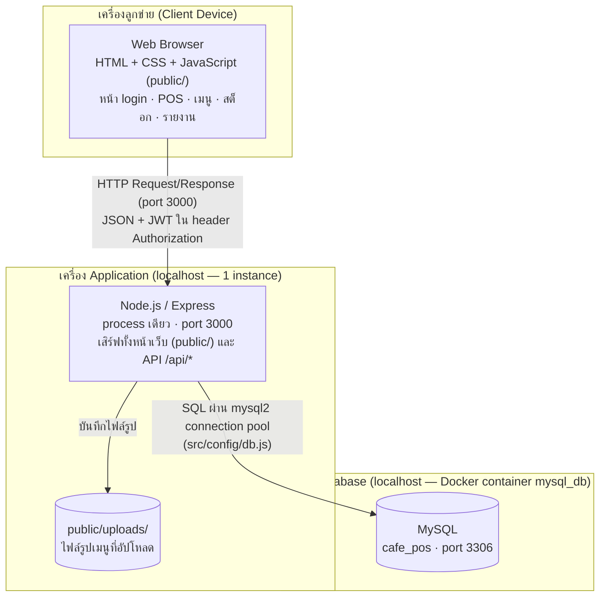
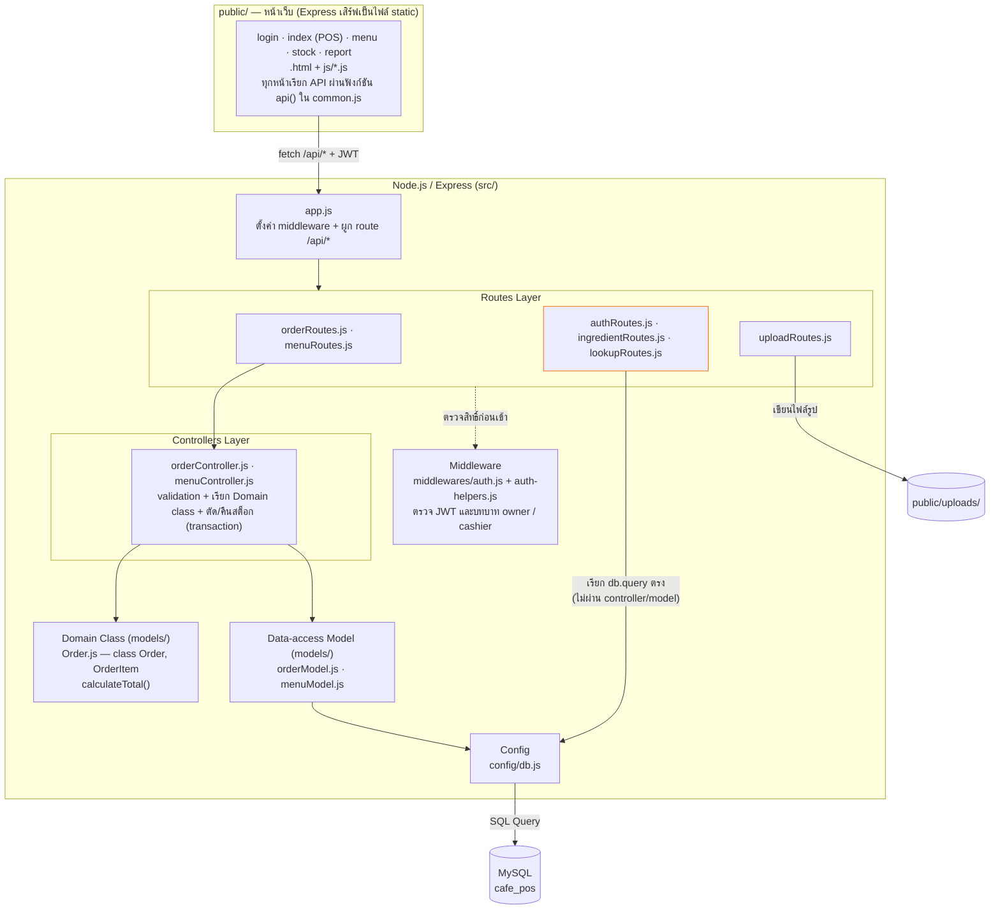

# สัปดาห์ที่ 11: Architecture Diagram (4+1 View) — Baristech Cafe POS

> **อ้างอิงโค้ดจริงจาก branch `week11/architecture`** (แตกจาก `week10/pos-ui`) โฟลเดอร์ `mc/` — เป็นโค้ดล่าสุดของกลุ่ม (branch `main` ยังเป็นโค้ดสัปดาห์ 6 เพราะยังไม่ได้ merge branch สัปดาห์ 7–11)
>
> **เอกสารมุมมองอื่นของ 4+1 View ที่มีอยู่แล้ว (ขั้นตอนที่ 1)**
>
> | 4+1 View | เอกสารเดิม | ไฟล์ใน repo |
> | :--- | :--- | :--- |
> | Scenarios (+1) | Use Case Diagram (สัปดาห์ 4) | `docs/images/wk04-usecase.png`, `docs/wk04-user-stories.md` |
> | Logical View | Class Diagram (สัปดาห์ 6) | `docs/images/wk06-class-diagram.png` |
> | Process View | Sequence Diagram (สัปดาห์ 9) | `docs/images/wk09-sequence-diagram.png` |
> | Physical View | ส่วนที่ 1 ของไฟล์นี้ | — |
> | Development View | ส่วนที่ 2 ของไฟล์นี้ | — |

---

## ส่วนที่ 1: Physical View

ระบบรันอยู่บน **เครื่องพัฒนาเครื่องเดียว** (laptop ของสมาชิกที่รันระบบ — แต่ละคนรันชุดของตัวเอง ไม่มีเซิร์ฟเวอร์กลาง):

| Node | ของจริงในกลุ่ม | หลักฐานใน repo |
| :--- | :--- | :--- |
| Client | Web browser เปิดหน้า `login.html`, `index.html` (POS), `menu.html`, `stock.html`, `report.html` | โฟลเดอร์ `public/` |
| Application Server | Node.js + Express รันเป็น process เดียวด้วย `npm run dev` ที่ `localhost:3000` | `package.json`, `src/app.js`, `.env.example` (`PORT=3000`) |
| Database Server | MySQL ใน Docker container `mysql_db` พอร์ต `3306` ฐานข้อมูล `cafe_pos` บนเครื่องเดียวกัน | `DATABASE_SETUP.md`, `src/config/db.js` |

**หมายเหตุ:** กล่อง Application กับ Database แยกกันตามบทบาท แต่ทางกายภาพอยู่บน laptop เครื่องเดียวกัน (MySQL อยู่ใน Docker) ไม่มี cloud, load balancer หรือเซิร์ฟเวอร์แยกตามสาขา — "หลายสาขา" จำลองด้วยคอลัมน์ `branch_id` ในฐานข้อมูลเดียว

---

## ส่วนที่ 2: Development View

### เลือกเวอร์ชัน (ก) — กลุ่มที่แยก Data-access Model แล้ว

ตรวจ `src/models/` ใน repo จริง (ตามหัวข้อ 3.4 ข้อ 1):

| ไฟล์ที่ควรมี | ชนิด | มีจริงไหม |
| :--- | :--- | :--- |
| `orderModel.js` | Data-access module | ✅ มี |
| `menuModel.js` | Data-access module | ✅ มี |
| `Order.js` (class `Order`, `OrderItem`, `calculateTotal()`) | Domain class (บังคับตาม wk06) | ✅ มี (เพิ่มในสัปดาห์ 11) |

กลุ่มมีทั้ง Domain class และ Data-access Model แยกกัน จึงใช้ **เวอร์ชัน (ก)**

> หมายเหตุ: `Order.js` เพิ่งเพิ่มในสัปดาห์ 11 (ค้างมาจาก Workshop สัปดาห์ 6 ข้อ 7) โดยเขียนให้ตรงกับ Class Diagram `docs/images/wk06-class-diagram.png` — attribute `orderId, createdAt, paymentMethod, items` และ method `addItem(item, quantity)`, `calculateTotal()`, `submit()` ส่วน `OrderItem` มี `quantity, unitPrice` และ `getSubtotal()` ก่อนหน้านี้ยอดรวมคำนวณด้วยการบวกตรงใน `orderController.js`

### ลำดับการเรียกตามชั้น — ตัวอย่าง "แคชเชียร์กดชำระเงิน"

`public/js/pos.js` → `POST /api/orders` → `middlewares/auth.js` (ต้องเป็น cashier) → `orderRoutes.js` → `orderController.createOrder()` (ตรวจข้อมูล, เช็กสต็อก) → สร้าง `new Order()` + `order.addItem()` + `order.calculateTotal()` (Domain class) → `menuModel.findIngredientsByMenuId()` + `orderModel.createOrder() / createOrderItem() / updateStockAndRecordMovement() / createReceipt()` ภายใน transaction เดียว → `config/db.js` → MySQL

### หน้าเว็บแต่ละหน้าเรียก API อะไร (ชั้น Presentation → Routes)

| หน้า (`public/`) | ไฟล์ JS | API ที่เรียก | ผ่าน Controller/Model ไหม |
| :--- | :--- | :--- | :--- |
| `login.html` | `login.js` | `POST /api/auth/login`, `GET /api/auth/me` | ❌ `authRoutes.js` เรียก DB ตรง |
| ทุกหน้า (แถบบน) | `common.js` | `GET /api/auth/me`, `GET /api/branches` | ❌ `authRoutes` / `lookupRoutes` |
| `index.html` (POS) | `pos.js` | `GET /api/menu`, `POST /api/orders`, `GET /api/orders`, `DELETE /api/orders/:id` | ✅ order/menu controller → model |
| `menu.html` | `menu.js` | `GET/POST/PUT/DELETE /api/menu`, `GET /api/categories`, `GET /api/ingredients`, `POST /api/uploads/menu-image` | menu ✅ · categories/ingredients/uploads ❌ |
| `stock.html` | `stock.js` | `GET/POST/PUT/DELETE /api/ingredients`, `POST /api/ingredients/:id/restock` | ❌ `ingredientRoutes.js` เรียก DB ตรง |
| `report.html` | `report.js` | `GET /api/orders`, `GET /api/orders/:id`, `DELETE /api/orders/:id` | ✅ (สรุปยอดคำนวณฝั่ง browser) |

### ผลตรวจสอบความสอดคล้องกับ repo (ขั้นตอนที่ 5 ตามหัวข้อ 3.4)

| ข้อ | สิ่งที่ตรวจ | ผล |
| :- | :--- | :--- |
| 1 | ไฟล์ใน `src/models/` | มี `Order.js` (domain class) และ `orderModel.js`, `menuModel.js` (data-access) → เวอร์ชัน (ก) |
| 2 | ทุกโฟลเดอร์/ไฟล์ใน `src/` อยู่ใน diagram | ครบ: `app.js`, `auth-helpers.js`, `config/db.js`, `controllers/` 2 ไฟล์, `middlewares/auth.js`, `models/` 3 ไฟล์, `routes/` 6 ไฟล์ — ไม่มีกล่องไหนที่ไม่มีไฟล์จริง |
| 3 | `config/db.js` ↔ MySQL | ใช้ `mysql2/promise` `createPool` อ่านค่าจาก `.env` (`DB_HOST`, `DB_PORT`, `DB_USER`, `DB_PASSWORD`, `DB_NAME`) ตรงกับลูกศร Config → MySQL |
| 4 | Physical View ตรงกับเครื่องที่ใช้จริง | 1 เครื่อง: Node.js `localhost:3000` + MySQL ใน Docker `mysql_db:3306` |
| 5 | ส่วนที่ยังไม่ตรง / แผนในอนาคต | (ก) `authRoutes`, `ingredientRoutes`, `lookupRoutes` เรียก `db.query` ตรง ข้ามชั้น controller/model · (ข) รายงานยอดขายยังสรุปฝั่ง browser จาก `GET /api/orders` ส่วน endpoint `/api/reports/sales` วางแผนไว้สัปดาห์ 13 จึงไม่วาดใน diagram |
| — | Transaction ของ `createOrder` | ✅ มีแล้ว — `createOrder` และการยกเลิกออเดอร์ใช้ `beginTransaction / commit / rollback` (เพิ่มตั้งแต่ branch `week9/order-transaction`) |

---

## ส่วนที่ 3: สรุปสถาปัตยกรรมของกลุ่ม

ระบบ Baristech Cafe POS ของกลุ่มเราใช้สถาปัตยกรรมแบบ **Monolithic + Layered** ที่เป็น Monolithic เพราะหน้าเว็บทั้ง 5 หน้าใน `public/`, API ทุกเส้นใต้ `/api/*` และโค้ดเข้าถึงฐานข้อมูลอยู่ใน codebase เดียวในโฟลเดอร์ `mc/` และ deploy เป็น Node.js process เดียวด้วย `npm run dev` ที่ `localhost:3000` ต่อกับ MySQL ใน Docker container `mysql_db` บน laptop เครื่องเดียวกัน ทีมเรามีสมาชิก ___ คน และมีเวลาพัฒนาไม่ถึงหนึ่งภาคเรียน การแยกเป็น microservices จะเพิ่มงาน deploy และการสื่อสารข้าม service โดยไม่ได้ประโยชน์ เพราะขอบเขตระบบยังอยู่แค่ รับออเดอร์/POS, จัดการเมนู, สต็อกวัตถุดิบ และรายงานยอดขาย ส่วน "หลายสาขา" ก็แยกด้วย `branch_id` ในฐานข้อมูลเดียวได้ ภายใน monolith เราแบ่ง layer เป็น routes → controllers → models → `config/db.js` ตามโครงที่ตั้งไว้ตั้งแต่สัปดาห์ 5 และตั้งแต่สัปดาห์ 7 ได้ย้าย SQL ของออเดอร์และเมนูออกจาก controller ไปไว้ใน `orderModel.js` / `menuModel.js` ส่วนการคำนวณยอดรวมอยู่ใน domain class `Order.js` (`calculateTotal()`) ตาม Class Diagram สัปดาห์ 6 และการตัดสต็อกใน transaction อยู่ใน `orderController.js` และในสัปดาห์ 10 เพิ่ม middleware `auth.js` แยกเรื่องสิทธิ์เจ้าของร้าน/แคชเชียร์ออกจาก business logic อย่างไรก็ตามการแบ่ง layer ยังไม่สมบูรณ์ คือ route ของ auth / ingredient / lookup ยังเรียก `db.query` ตรงโดยไม่ผ่าน controller และ model ซึ่งกลุ่มวางแผนจะแยกให้ครบในสปรินต์ถัดไป
